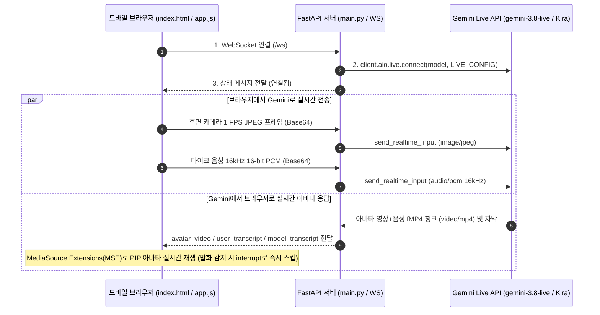

# Gemini Live 모바일 카메라 & 아바타 어시스턴트 샘플 (`gemini-live-sample`)

모바일 웹 브라우저에서 **후면 카메라 영상(1 FPS JPEG)**과 **마이크 음성(16kHz PCM)**을 실시간으로 **Gemini Live API (`gemini-3.8-live`)**에 스트리밍하여, 화면에 비춘 수학 문제나 사물에 대해 질문하면 **실시간 아바타(`Kira` + `Leda` 음성, `video/mp4` fMP4 스트림)**와 한국어 자막으로 답변하는 초경량 샘플 애플리케이션입니다.

---

## 1. 아키텍처 및 데이터 흐름



---

## 2. 프로젝트 파일 구조

```text
gemini-live-sample/
├── main.py              # FastAPI 백엔드 (브라우저 WebSocket ↔ Gemini Live API 양방향 브리지)
├── static/
│   ├── index.html       # 모바일 전체 화면 UI (후면 카메라 프리뷰 + 우측 상단 PIP 아바타 + 자막)
│   └── app.js           # 카메라 1 FPS 캡처, 16kHz PCM 마이크 입력, MSE 기반 아바타(video/mp4) 재생
├── requirements.txt     # 필수 Python 패키지 (google-genai, fastapi, uvicorn, python-dotenv)
├── Dockerfile           # Cloud Run 배포용 컨테이너 이미지 정의 (python:3.11-slim)
├── .env                 # 로컬 실행용 환경 변수 설정 파일 (Git 추적 제외)
├── .gitignore           # Git 버전 관리 제외 목록 (.env, .venv, 인증서 등)
├── .dockerignore        # Docker 빌드 컨텍스트 제외 목록
└── .gcloudignore        # Cloud Run 소스 배포 제외 목록
```

---


## 3. 환경 변수 설정 (`.env`)

```bash
export PROJECT_ID=[your-project-id]
export SERVICE_ACCOUNT=sa-gemini-live
export LOCATION=us-central1
```

---

## 4. Google Cloud Run 배포 방법 (전용 서비스 계정 생성 포함)

Cloud Run 컨테이너가 `aiplatform.endpoints.predict` 를 호출할 수 있도록 전용 서비스 계정(`gemini-live-sa`)을 생성하고 최소 권한을 부여한 뒤 배포합니다.

### 1) 환경설정
필요한 GCP API 활성화:
```bash
gcloud services enable run.googleapis.com \
                       cloudbuild.googleapis.com \
                       artifactregistry.googleapis.com \
                       aiplatform.googleapis.com
```


### 2) 전용 서비스 계정(SA) 생성 및 권한 설정
```bash
# 서비스 계정 이메일 주소 정의 (자동 매칭)
export SA_EMAIL="${SERVICE_ACCOUNT}@${PROJECT_ID}.iam.gserviceaccount.com"

# 서비스 계정 생성
gcloud iam service-accounts create ${SERVICE_ACCOUNT} \
    --description="Gemini Live Sample Service Account"

# 필요한 IAM 역할 목록
ROLES=(
    "roles/aiplatform.user"   # Gemini Live API 호출 권한 부여
    "roles/logging.logWriter" # Cloud Logging 로그 기록 권한 부여
)

# 반복문을 통해 권한 일괄 부여
for ROLE in "${ROLES[@]}"; do
    gcloud projects add-iam-policy-binding ${PROJECT_ID} \
        --member="serviceAccount:${SA_EMAIL}" \
        --role="${ROLE}"
done
```

### 3) Cloud Run 서비스 배포
```bash
gcloud run deploy gemini-live-sample \
  --source=. \
  --project=${PROJECT_ID} \
  --region=${LOCATION} \
  --service-account=${SA_EMAIL} \
  --allow-unauthenticated \
  --set-env-vars=GOOGLE_GENAI_USE_ENTERPRISE=TRUE,GOOGLE_CLOUD_PROJECT=${PROJECT_ID},GOOGLE_CLOUD_LOCATION=${LOCATION} \
  --timeout=3600 \
  --quiet
```
